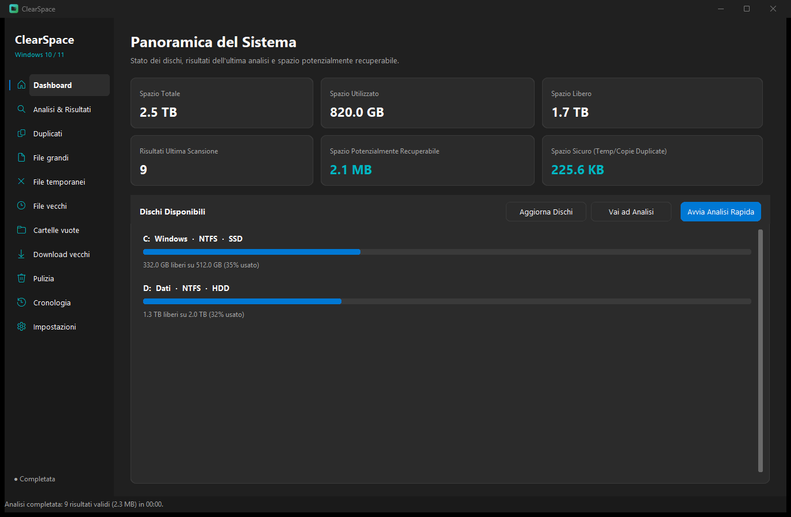
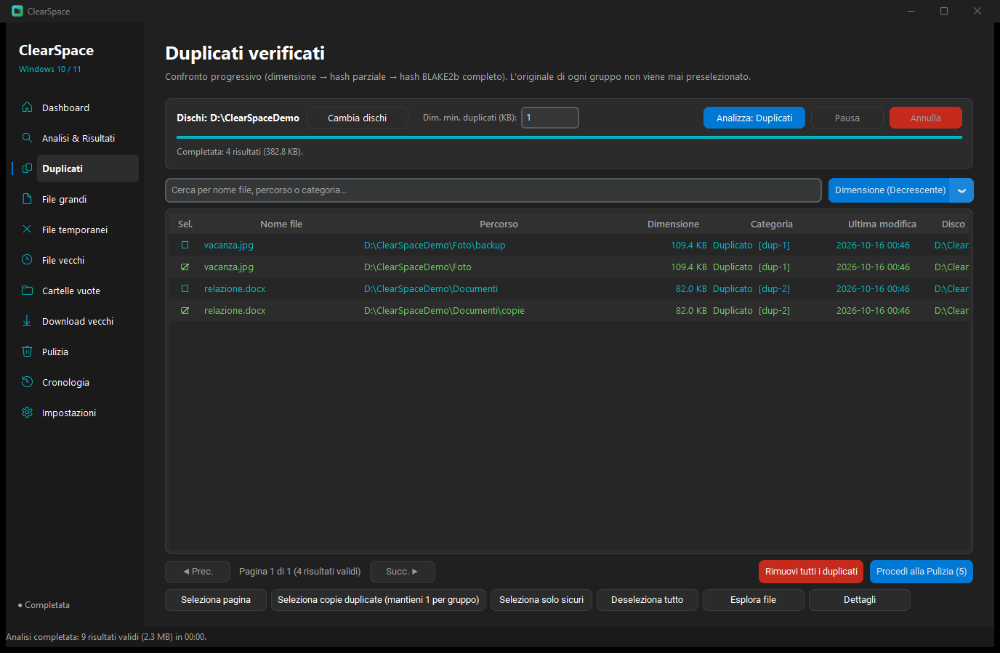
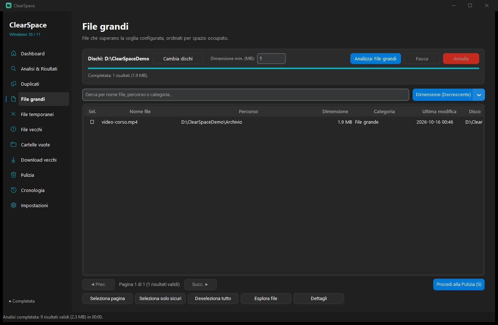
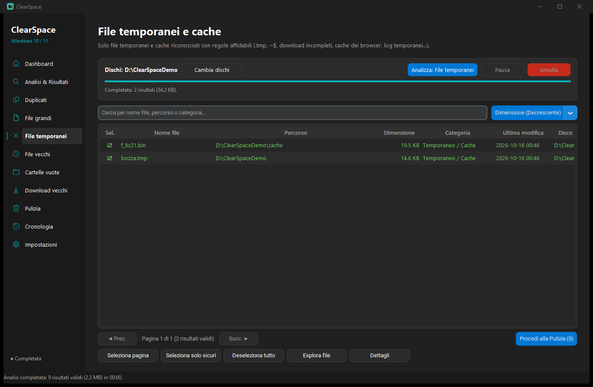
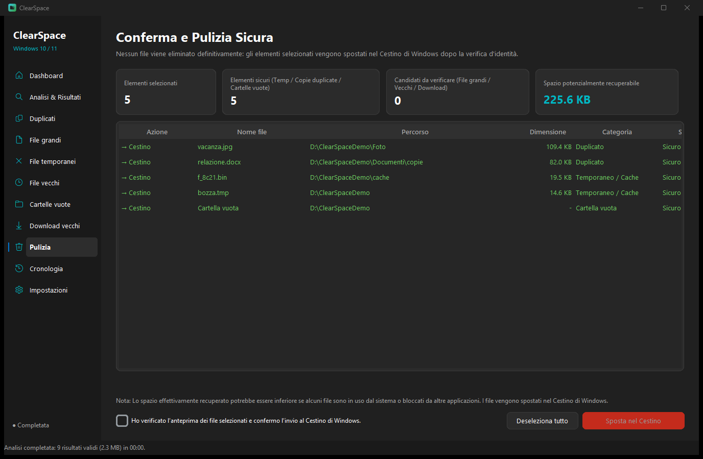

# ClearSpace

ClearSpace è un programma per Windows 10 e Windows 11. Guarda quanto spazio occupano i file sul disco e ti lascia scegliere cosa spostare nel Cestino.

Non cancella nulla da solo. Non si collega a internet. I file restano sul tuo PC.

Le schermate qui sotto usano una cartella di esempio.

## Com'è fatto

### Panoramica

La prima pagina mostra lo spazio dei dischi, i risultati dell'ultima analisi e quanto si può recuperare.

### Duplicati

I file uguali sono confrontati per intero. Di ogni gruppo resta selezionabile solo la copia: l'originale non viene preso.

### File grandi

Qui compaiono solo i file più grandi della soglia che imposti.

### File temporanei

Solo file temporanei e cache riconosciuti, per esempio `.tmp` e i file di cache del browser.

### Pulizia

Prima di spostare qualcosa nel Cestino vedi l'elenco e devi confermare. Nulla viene cancellato in modo definitivo.

## Installazione

1. Scarica **ClearSpace-Setup.exe** da questa pagina.
2. Aprilo. Se Windows mostra un avviso, è perché il file non ha una firma a pagamento: usa **Ulteriori informazioni** e poi **Esegui comunque** solo se il file arriva da questa pagina.
3. Conferma l'installazione.
4. ClearSpace si apre. Trovi anche un collegamento sul desktop e nel menu Start.

Per toglierlo, elimina la cartella `%LOCALAPPDATA%\ClearSpace` e i collegamenti chiamati ClearSpace.

## Uso

1. Scegli il disco da controllare.
2. Apri la categoria che ti interessa: duplicati, file grandi, file temporanei, file vecchi, cartelle vuote o download vecchi.
3. Premi **Analizza**.
4. Seleziona solo quello che vuoi togliere e spostalo nel Cestino. Puoi recuperarlo dal Cestino finché non lo svuoti.

ClearSpace non tocca Windows, i programmi installati, né i file di password, chiavi o portafogli.
